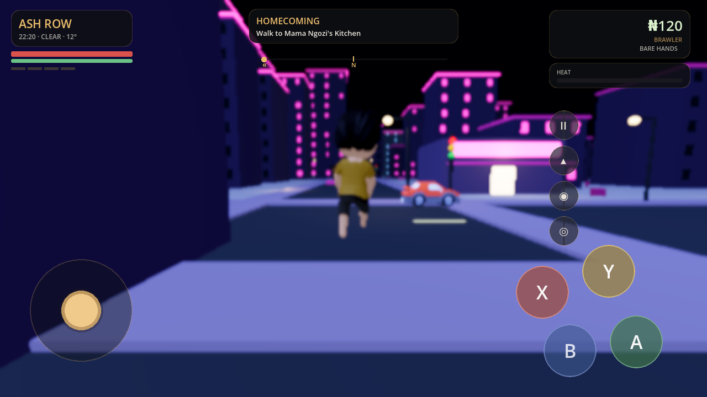
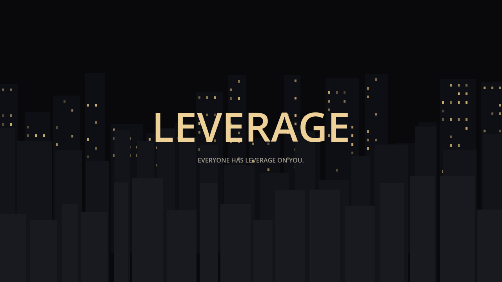
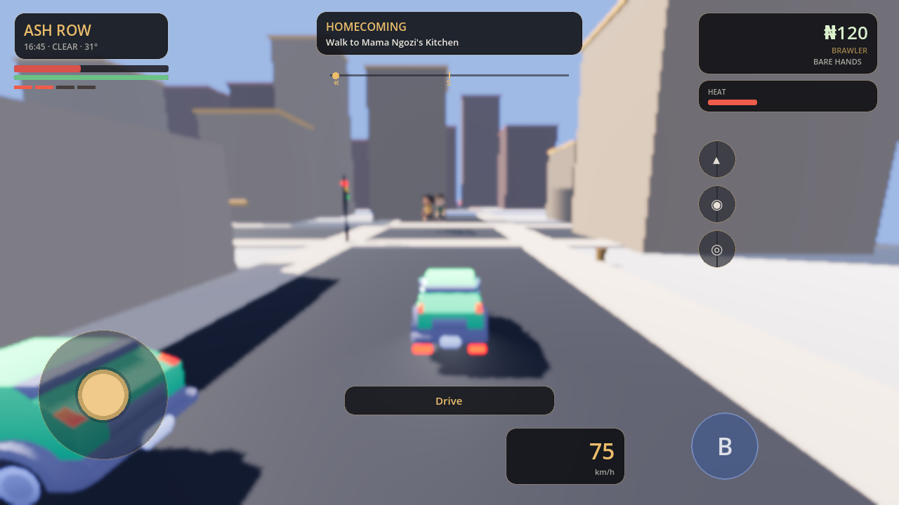
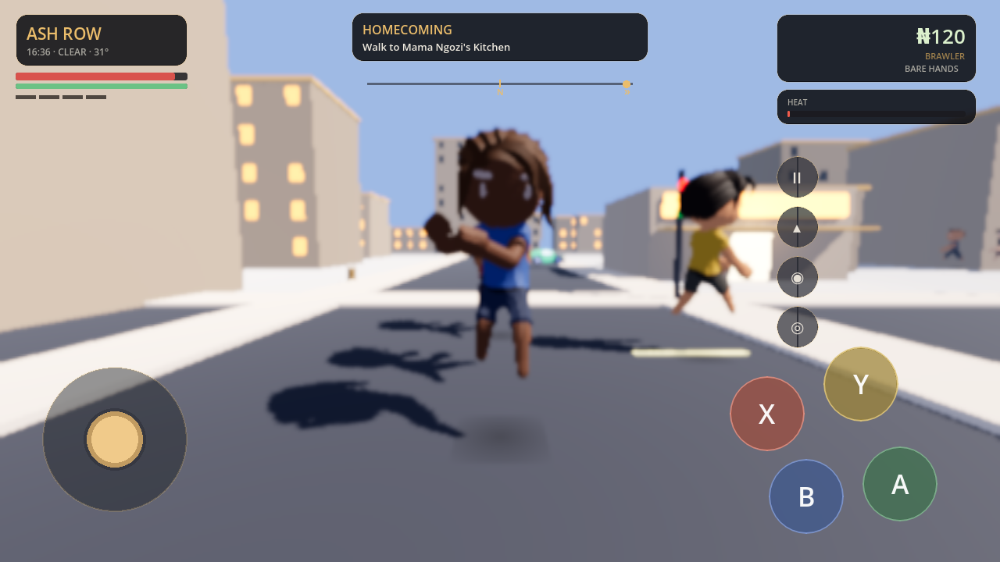
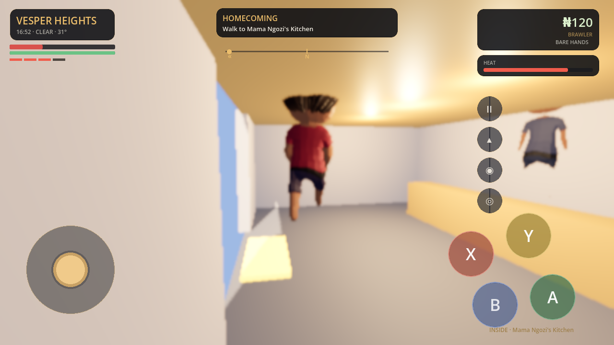

# LEVERAGE

> **Everyone has leverage on you.**

A third-person open-world crime-action game set in **Cinder City**, built in **Godot 4.7.2**
with the **Mobile renderer**, targeting iPhone via **XOGOT**.



---

## What this is

Your brother owes ₦4.2 million to the Neon Mile Crew, and they have stopped asking
nicely. You are Emeka Obi — five martial disciplines, a phone full of people who owe you
favourites, and a city that only respects leverage.

Six connected districts. Live traffic. Pedestrians with schedules and memory. A police
force that responds to heat in four escalating tiers. Enterable interiors, day/night,
weather, and a money/heat/reputation/trust economy.

## Status

| | |
|---|---|
| Automated tests | **112 passing, 0 failing** |
| Script errors | **0** |
| Code | ~6,000 lines GDScript, 30 files |
| Documentation | 17 documents |
| Verification frames | 20 rendered screenshots |

**Playable end-to-end:** opening flow → main menu → third-person movement → five-discipline
combat → vehicle entry and driving → traffic → police pursuit → interiors → map → phone.

**Not finished:** four of six story missions have data and objectives but no bespoke
scripted set-pieces. Audio imports and every call site is wired but **has never been heard**
(the build environment has no audio device). iPhone frame rate, safe-area insets and touch
feel are unverified — see `docs/11_KNOWN_DEFECTS.md`.

This project does not claim to be finished. It claims to be honest.

## Screenshots

| | |
|---|---|
|  |  |
|  |  |

Full set with captions: [`shots/00_CONTACT_SHEET.png`](shots/00_CONTACT_SHEET.png) and
[`docs/15_SCREENSHOT_INDEX.md`](docs/15_SCREENSHOT_INDEX.md).

## Controls

Movement is touch-first (virtual stick + camera drag). Combat buttons are fixed:

| Button | Action |
|--------|--------|
| **X** | Punch |
| **Y** | Heavy attack |
| **A** | Kick |
| **B** | Dodge in combat / contextual interaction outside combat |

Keyboard equivalents exist for development. Full map: [`docs/05_CONTROL_MAP.md`](docs/05_CONTROL_MAP.md).

## Running it

Requires **Godot 4.7.x**.

```bash
godot --path .                  # play
godot --headless --path . res://tests/test_suite.tscn   # 112 tests
```

First open reimports assets (no `.godot/` cache in the repo) — this takes 20–60 seconds
and is normal.

## Documentation

Start at [`docs/00_README.md`](docs/00_README.md). The two most useful documents:

- [`docs/09_REQUIREMENTS_TRACEABILITY.md`](docs/09_REQUIREMENTS_TRACEABILITY.md) — every
  requirement with an honest IMPLEMENTED / TESTED / VERIFIED / DEVICE-ONLY status.
- [`docs/12_DEVELOPMENT_STATE.md`](docs/12_DEVELOPMENT_STATE.md) — where the project is
  and the exact next action.

## Credits & licensing

- **Characters & animation** — Quaternius / misty-3d Universal Animated Character pack (CC0)
- **Vehicles** — Kenney Car Kit (CC0)
- **Audio** — 32 files synthesized from first principles for this project (original work)
- **Engine** — Godot 4.7.2 (MIT)

No asset in this game requires attribution. Full record:
[`docs/06_LICENCE_RECORD.md`](docs/06_LICENCE_RECORD.md).

---

© 2026 D'Youngs Games.
